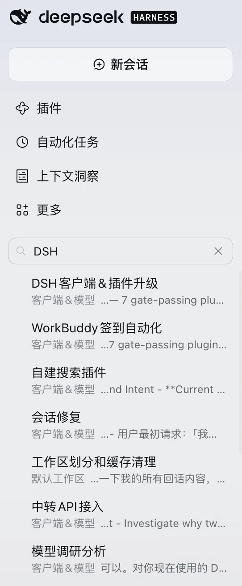

# dsh-gui-search

让 DeepSeek Harness 侧边栏的搜索框能搜**聊天正文**，而不只是会话标题。

以前搜一个词，只有标题命中的会话才会出现——明明聊过，却搜不到。装上它之后，同一个搜索框直接搜正文内容，**点一下就能跳到命中的那条消息并高亮**。

<p align="center">
  
</p>

上图中搜索「DSH」，出来 7 条会话，每条下面都带一段**正文摘要**——这些内容原本是搜不到的，这就是它的效果。

## 它能做什么

- **搜正文**：在原搜索框输入关键词，直接匹配会话里的聊天内容
- **点击直达**：点搜索结果，自动打开会话、向前翻页加载历史、滚动到命中消息并闪烁高亮
- **中文友好**：中日韩文字都能搜，**单个汉字也能搜**，不区分大小写
- **多词「且」关系**：`插件 冲突` 要求两个词都出现
- **结果排序**：总出现次数 → 最近时间 → 会话新旧

## 快速安装

**方式一：界面安装（推荐，桌面版用户）**

打开 DSH，点左侧 **插件 → 添加插件**，把下面这个地址粘进去：

```text
https://github.com/Dmatterdj/dsh-gui-search
```

**方式二：命令行安装**

```bash
dsh plugin add github:Dmatterdj/dsh-gui-search
```

装完**重启 DSH** 生效。

> 命令行方式需要机器上有 `dsh` 命令。用桌面版安装包装的 DSH 默认不带这个命令，请用方式一。

**方式三：写进配置文件**

```yaml
# cordis.patch.yml
- insert:
    - id: gui-search
      name: 'dsh-gui-search'
      config:
        debug: false
```

保存后重启 DSH 生效。

**方式四：本地开发**

```bash
dsh plugin add /你的路径/dsh-gui-search
```

改代码立即生效，不用重装。

### 复制给 AI 助手

把下面这段发给 Claude Code、Codex、Cursor 等任意能执行命令的助手，它会自己判断该走哪条路：

```text
帮我安装 DeepSeek Harness 插件 dsh-gui-search。

先检查机器上有没有 dsh 命令：

- 如果有，执行：dsh plugin add github:Dmatterdj/dsh-gui-search
- 如果没有（桌面版安装包不带这个命令），就告诉我：
  在 DSH 界面点「插件 → 添加插件」，填入
  https://github.com/Dmatterdj/dsh-gui-search

这个插件让 DSH 侧边栏搜索框能搜会话正文内容（支持中文和单字），
点击搜索结果可以跳转到命中的那条消息。

不管走哪条路，装完都要提醒我重启 DSH。
项目地址：https://github.com/Dmatterdj/dsh-gui-search
```

---

以下是技术细节，不关心可以略过。

## 与官方搜索的对比

| 能力 | 官方 | 本插件 |
|---|---|---|
| 匹配会话标题 | 支持 | 支持 |
| 匹配消息正文 | 不支持 | **支持** |
| 中日韩文字子串 | 不支持 | **支持** |
| 一两个字的短词 | 不支持 | **支持** |
| 跳到命中消息 | 不支持 | **支持** |
| 高亮命中处 | 不支持 | **支持** |

## 为什么官方索引搜不到中文

DSH 自带一个可选的 SQLite FTS5 索引，建表时用的是 `unicode61` 分词器：

```sql
CREATE VIRTUAL TABLE persisted_docs USING fts5(..., tokenize = 'unicode61')
```

`unicode61` 不切分中日韩文字：**一串连续汉字会被当成一个 token**，而查询又被整体包成一个 FTS5 短语。所以搜 `搜索` 永远匹配不到包含 `全文搜索` 的消息——索引里存的是整串，查询要的是另一串。

这是实测结果，不是推测：

| 查询词 | FTS5 `unicode61` | 本插件字面子串 |
|---|---|---|
| `zstd` | 1 命中 | 1 命中 |
| `指纹` | **0 命中** | 1 命中 |
| `插件` | **0 命中** | 1 命中 |
| `插件冲突` | **0 命中** | 1 命中 |
| `帧`（单字） | **0 命中** | 1 命中 |

英文词两边都能搜到；中文词只有本插件能搜到。

## 使用

在侧边栏搜索框直接输入即可，用法和原版一样，只是多了正文匹配。

- **多个词是「且」的关系**：`插件 冲突` 要求两个子串都出现。
- **不区分大小写**，任何语言都行，单字也支持。
- **结果排序**：先按总出现次数，再按最近时间，最后按会话新旧。
- 搜索空词、或只按标题过滤的请求，原样交回官方实现处理。

## 工作原理

插件分成两半。

**Host 半部分**（`index.js`）只替换一个方法：`sessionQuery.searchSessions`。文档仍然通过继承来的 `sessionQuery.filterEvents()` 读取，所以鉴权、活跃/持久偏好、正文提取都留在内核代码里。标题搜索、精确读取、trace、过滤器全部保持原样。

**Client 半部分**（`lib/client.js`）负责跳转定位。官方结果行只带会话 ID，不带消息位置，所以点结果只会打开会话、不会跳到命中处。这部分接住结果行的点击，记住查询词，然后：

1. 向 Host 询问命中的 `seq`；
2. 向前翻页，直到该 `seq` 进入已加载窗口；
3. 找到对应的 DOM 行，滚动到不被输入框遮挡的位置，闪烁并高亮全部命中。

新打开的会话会自动滚到底部，会把第一次滚动覆盖掉。跳转会持续重试，直到该行稳定停在输入框上方的安全区内，从而稳定赢得这个竞态。

## 配置

| 键 | 类型 | 默认值 | 说明 |
|---|---|---|---|
| `debug` | boolean | `false` | 把匹配和激活日志追加到 `$DSH_HOME/gui-search.log`，不影响搜索行为。 |

## 接口

只有一个只读接口，且限制为同源本机调用：

| 接口 | 用途 |
|---|---|
| `GET /api/gui-search/health` | 返回 `{ ok, name, sessions, installed }`，确认补丁已生效、缓存了多少会话 |
| `GET /api/gui-search/locate?session=<id>&q=<query>` | 返回 `{ ok, seq, time, type, snippet, count }`，某会话内最匹配的消息位置 |

`locate` 会在 `snippet` 里返回对话原文，所以设了围栏：`Host` 头必须是本机回环地址，带 `Sec-Fetch-Site: cross-site` 的请求直接拒绝，有 `Origin` 时必须与请求的 `Host` 一致。

## 兼容性

- 要求 DSH `>=0.2.1-rc.2 <0.3.0`。
- 在客户端 `0.2.1-rc.5`（Host 协议 4）上测试通过。
- 零运行时依赖，无构建步骤。
- 不修改 `app.asar`，不直接读取会话文件。

## 已知限制

- **不注册任何工具**，这是刻意的。注册 `session_search` 这类工具会和 `@deepseek-ai/dsh-tool-session-query` 撞名，导致内置会话工具失效。本插件零工具，因此不与任何插件冲突。
- 精确跳转依赖内部的对话快照。如果某个版本没有暴露它，会退回到「找第一个包含查询词的文本节点」，当同一段话在一个会话里重复出现时可能选错行。搜索结果本身不受影响。
- 会话级筛选（`sessionFilters`）交回原实现处理，因此这类请求保持官方的「只搜标题」语义。
- 只索引 `user/message` 和 `assistant/message`，不索引工具输出和思考过程。

## 许可

MIT
